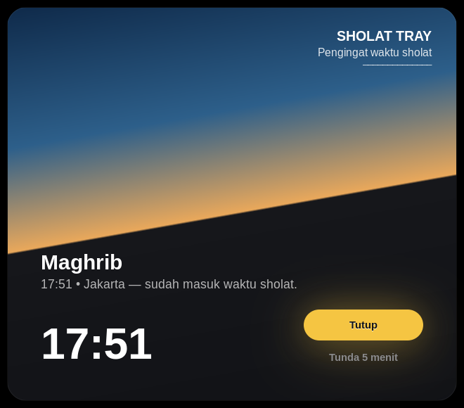
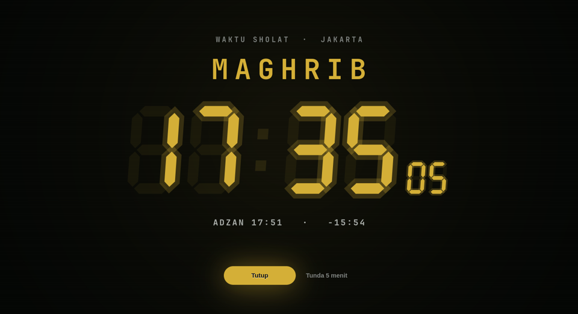

# Sholat Tray

Pengingat waktu sholat untuk desktop Linux. Halaman proyek: **https://ibeeng.github.io/sholat-tray/**

Ikon di tray dengan jadwal hari ini, notifikasi 10 menit sebelum waktu sholat, layar pengingat saat masuk waktu, dan adzan.

Jalan di **Omarchy / Hyprland** (lengkap dengan widget hitung mundur di bar), **XFCE**, **KDE**, dan desktop lain yang punya system tray.

| Gaya Kartu | Gaya Digital |
|---|---|
|  |  |

Gaya Teks berjalan, banner tipis yang tidak menutup layar:


## Fitur

- Jadwal Imsak, Subuh, Terbit, Dhuha, Dzuhur, Ashar, Maghrib, Isya, plus tanggal Hijriah
- Lokasi otomatis dari IP, atau set kota sendiri
- Dua sumber jadwal: **AlAdhan** (koordinat, metode Kemenag RI) atau **MyQuran** (jadwal resmi kota Indonesia)
- Notifikasi 10 menit sebelum waktu sholat
- Layar pengingat saat masuk waktu sholat wajib, dengan 4 gaya:
  - **Kartu**: kartu bergambar langit di atas desktop yang di-blur
  - **Digital**: jam 7-segmen besar ala jam masjid, lengkap dengan hitungan sejak adzan
  - **Teks berjalan**: banner running text di atas layar; tidak menutup kerjaan, tidak merebut fokus
  - **Minimal**: nama sholat besar dan lafaz *hayya 'alash-shalah* di atas desktop yang di-blur
- Tutup dengan tombol atau `Esc`, atau tunda 5 menit (gaya Teks berjalan: klik kiri tutup, klik kanan tunda)
- Adzan otomatis (adzan Subuh bisa beda file), dengan tombol stop dan tes
- Jadwal satu bulan penuh
- Warna: ikut tema Omarchy, atau preset Senja, Subuh, Masjid, Malam. Bebas dipadukan dengan gaya mana pun
- Omarchy: widget bar `󱠧 Maghrib · 38m` yang menyala saat waktu sholat tinggal 10 menit

## Pasang

Dependensi:

```bash
# Arch / Omarchy
sudo pacman -S python-gobject gtk3 libayatana-appindicator libnotify ffmpeg grim

# Debian / Ubuntu / Linux Mint
sudo apt install python3-gi gir1.2-gtk-3.0 gir1.2-ayatanaappindicator3-0.1 libnotify-bin ffmpeg
```

Lalu:

```bash
git clone https://github.com/ibeeng/sholat-tray.git
cd sholat-tray
./install.sh
```

Installer bekerja per user (tanpa sudo):

- `sholat-tray` ke `~/.local/bin/`, ikon dan entri menu aplikasi
- **Omarchy:** widget bar `ibeeng.sholat-tray` (di sebelah jam), window rules Hyprland di `~/.config/hypr/sholat_tray.lua`, dan autostart
- **Desktop lain:** autostart lewat `~/.config/autostart/sholat-tray.desktop`

Hapus dengan `./uninstall.sh`. Config dan file adzan tidak ikut terhapus.

### Omarchy vs desktop lain

- **Omarchy:** semua kontrol ada di widget bar. Klik widget untuk jadwal hari ini, jadwal bulanan, adzan on/off, coba layar pengingat, dan memilih gaya serta warna. Klik kanan saat adzan berbunyi untuk menghentikannya. Ikon tray tidak ditampilkan supaya tidak dobel.
- **XFCE, KDE, dll.:** kontrol yang sama ada di menu ikon tray.

Atur lewat `TRAY=auto|1|0` di config kalau ingin memaksa ikon tray tampil atau sembunyi.

### Adzan

File audio adzan **tidak disertakan**. Taruh file milikmu sendiri di:

```
~/.local/share/sholat-tray/adzan.mp3        # Dzuhur, Ashar, Maghrib, Isya
~/.local/share/sholat-tray/adzan-fajr.ogg   # Subuh
```

Atau arahkan ke file lain lewat `ADZAN_FILE` / `ADZAN_FAJR_FILE` di config.

## Pengaturan

Kebanyakan bisa diatur dari widget bar atau menu tray: gaya, warna, sumber jadwal, adzan on/off. Sisanya di `~/.config/sholat-tray/sholat-tray.conf`:

```ini
AUTO=1                 # 1 = lokasi dari IP, 0 = pakai CITY di bawah
CITY=Jakarta
COUNTRY=Indonesia
SOURCE=aladhan         # aladhan | myquran
METHOD=20              # metode hitung AlAdhan (20 = Kemenag RI)
MYQURAN_CITY=          # nama kota untuk MyQuran (kosong = ikut CITY/lokasi)
MYQURAN_ID=            # atau langsung id kota MyQuran
GAYA=kartu             # kartu | digital | teks | minimal
TEMA=omarchy           # warna: omarchy | senja | subuh | masjid | malam
TRAY=auto              # auto = sembunyi kalau widget bar Omarchy terpasang
ADZAN=1
ADZAN_VOLUME=80        # 0-100 (ffplay)
ADZAN_FILE=~/.local/share/sholat-tray/adzan.mp3
ADZAN_FAJR_FILE=~/.local/share/sholat-tray/adzan-fajr.ogg
```

### Perintah

Saat Sholat Tray berjalan, perintah ini diteruskan ke aplikasi yang sudah jalan (dipakai juga oleh widget bar):

```bash
sholat-tray test-overlay Maghrib digital   # coba layar pengingat
sholat-tray style teks                     # kartu | digital | teks | minimal
sholat-tray color masjid                   # omarchy | senja | subuh | masjid | malam
sholat-tray monthly                        # jadwal bulanan
sholat-tray adzan toggle                   # on | off | toggle
sholat-tray stop-adzan
sholat-tray refresh                        # muat ulang jadwal + cek lokasi
sholat-tray --preview digital malam        # pratinjau tanpa aplikasi berjalan
sholat-tray --help
```

### XFCE panel (opsional)

Untuk menampilkan hitung mundur langsung di panel XFCE, tambahkan **Generic Monitor** dengan perintah `sholat-tray-genmon` dan periode 30 detik.

## Privasi dan jaringan

Sholat Tray tidak punya server sendiri. Aplikasi ini memanggil:

| Layanan | Untuk | Kapan |
|---|---|---|
| `ip-api.com` | perkiraan kota dan koordinat dari IP (HTTP) | tiap 30 menit, hanya jika `AUTO=1` |
| `api.aladhan.com` | jadwal sholat dan tanggal Hijriah | sekali sehari, dan saat membuka jadwal bulanan |
| `api.myquran.com` | jadwal kota Indonesia | sekali sehari, hanya jika `SOURCE=myquran` |

Set `AUTO=0` dan `CITY=...` kalau tidak ingin lokasi dideteksi dari IP. Semua cache disimpan lokal di `~/.cache/sholat-tray/`.

## Lisensi

MIT © 2026 ibeeng. Lihat [LICENSE](LICENSE).

Jadwal sholat bersumber dari [AlAdhan](https://aladhan.com) dan [MyQuran](https://api.myquran.com). Selalu cocokkan dengan jadwal masjid setempat.
